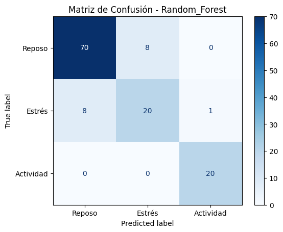
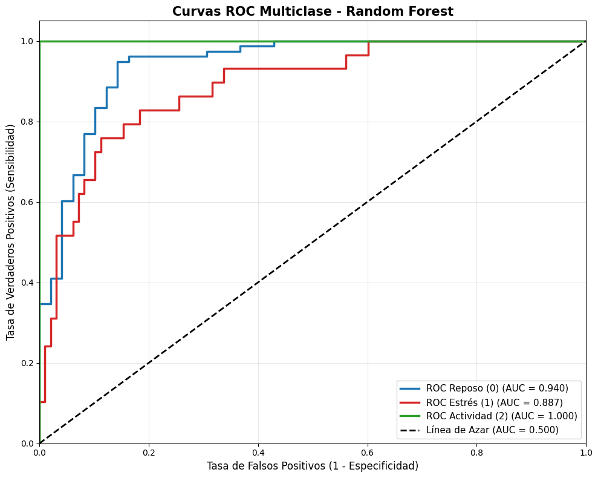
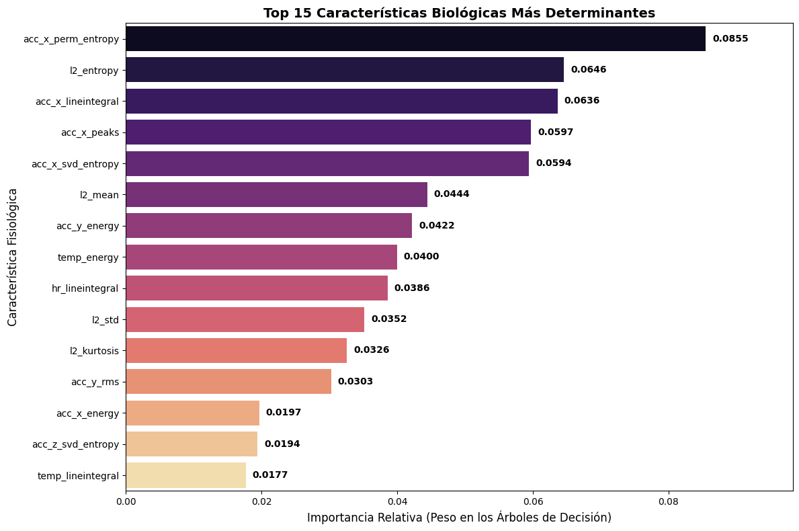

# Wearable Stress & Activity Classification

> A machine learning pipeline that classifies three physiological states (Rest, Cognitive Stress, Physical Activity) from Empatica E4 wearable data, evaluated on patients the model has never seen.

## Project Overview

The goal is to distinguish three physiological states using non-invasive wearable data. Physical activity is easy to detect from movement; the real challenge is telling **cognitive stress** apart from **rest**, since both involve little movement.

The project covers the full pipeline: signal feature extraction, data quality checks, leakage-safe splitting, class-imbalance handling, hyperparameter search across six models, and an honest look at what the model actually relies on.

**Classes predicted**

| Label | State |
|---|---|
| `0` | Rest / Baseline |
| `1` | Cognitive Stress |
| `2` | Physical Activity |

> ⚠️ This is a learning and research project built during a Samsung Innovation Campus AI course. It is **not** a medical device and must not be used for diagnosis.

## 📊 Dataset

Data was collected with the **Empatica E4** wristband, which records:

* **ACC:** 3-axis accelerometer
* **BVP:** Blood Volume Pulse (used to derive HRV)
* **EDA:** Electrodermal Activity
* **TEMP:** Skin temperature
* **HR:** Heart rate

🔗 **Source:** [Wearable Device Dataset (PhysioNet)](https://physionet.org/content/wearable-device-dataset/1.0.1/Wearable_Dataset/)

Please refer to the original authors for the experimental protocol, license and citation requirements. The stress and anaerobic-exercise sessions are used; the aerobic sessions are not part of the final model.

## Methodology & Pipeline

### 1. Feature extraction (`flirt`)
Statistical, time-domain and frequency-domain features were extracted from each labeled segment with the [`flirt`](https://github.com/im-ethz/flirt) toolkit. This yields 179 columns per segment.

### 2. Data quality
* **Anomalies:** removed columns with infinite values (e.g. `-inf` from `log(0)` in entropy features during zero-movement windows) or zero variance.
* **Redundancy:** removed 91 features with Pearson correlation > 0.85, leaving **77 features** for 662 segments.

### 3. Preventing data leakage
The train/test split uses **`GroupShuffleSplit`** grouped by patient ID (`PxID`), so all segments from a patient stay in the same set. The model is evaluated on **patients it never saw**, which measures generalization rather than memorization of individual baselines.

### 4. Class imbalance
'Rest' segments outnumber 'Stress' segments. To avoid a majority-class bias:
* models use `class_weight='balanced'` where supported;
* `GridSearchCV` optimizes **macro F1** instead of accuracy.

### 5. Modeling
Six models were tuned with grid search: Random Forest, XGBoost, SVM, Logistic Regression, MLP and KNN.

## Results

Held-out patients, macro F1 and accuracy:

| Model | Macro F1 | Accuracy |
|---|---|---|
| **Random Forest** | **0.858** | **0.866** |
| XGBoost | 0.834 | 0.858 |
| SVM | 0.802 | 0.803 |
| Logistic Regression | 0.764 | 0.787 |
| KNN | 0.708 | 0.740 |
| MLP | 0.706 | 0.780 |

**Random Forest, per class (F1):** Rest 0.90 · Stress 0.70 · Physical Activity 0.98.
Cross-validated macro F1 is lower (0.766), which is expected with such a small number of patients. Stress is the hardest class and the main source of errors, mostly confused with rest.

### Confusion matrix


### Multiclass ROC-AUC (one-vs-rest)
Physical Activity is separated almost perfectly; Rest and Stress show strong but not perfect separation.



### Feature importance
The most important features are dominated by the **accelerometer**, which is what separates physical activity from the other two states, followed by **skin temperature** and **heart rate**. Electrodermal (EDA) features do not appear among the top 15, so the model should not be read as detecting stress through EDA peaks. Separating stress from rest remains the open challenge, and a larger group of patients would be needed to improve it.



## Limitations

* Small number of patients; results can change noticeably with another split.
* Stress vs. rest is the weakest part of the model (F1 0.70).
* Controlled-protocol data from one device; no claim of performance in daily life.
* Not validated clinically.

## How to Run

1. Clone the repository:
   ```bash
   git clone https://github.com/MarioAdanPF/wearable-stress-activity-classification.git
   cd wearable-stress-activity-classification
   ```

2. Install the dependencies:
   ```bash
   pip install -r requirements.txt
   ```

3. Download the dataset from the link above and place the `AEROBIC`, `ANAEROBIC` and `STRESS` folders inside a `data/` directory.

4. Run the notebooks in order:
   1. `biosignals_featureExtraction.ipynb`
   2. `biosignals_modelTraining.ipynb`

## Acknowledgements

Thanks to the authors of the `flirt` library and to the researchers who released the Empatica E4 dataset openly.
